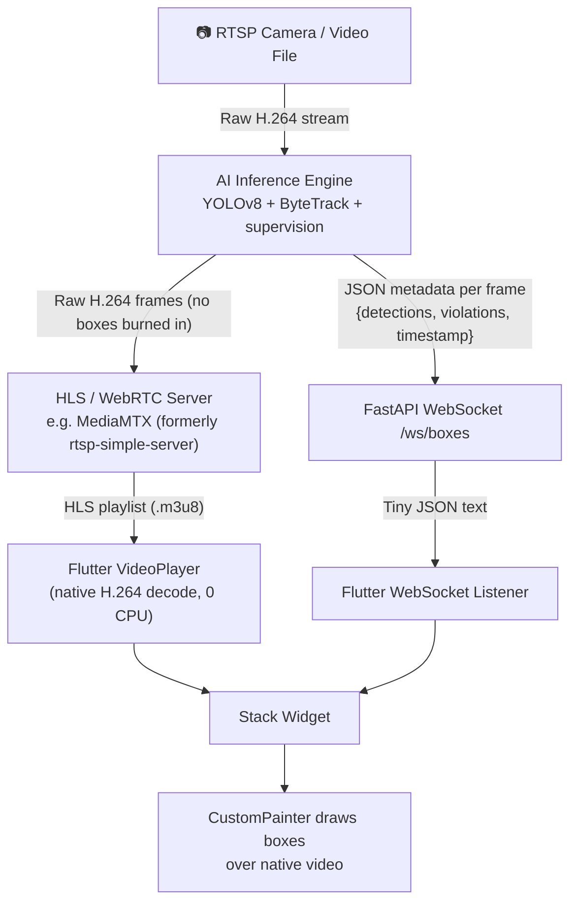

# Huli-Kamote: Better Architecture Research Plan

> [!IMPORTANT]
> The core gap identified: **Your violation detection pipeline is already architecturally correct.** The lagginess comes from HOW video is transported (base64 JPEG) — not from the AI logic itself. The plan below separates what to borrow, what to train, and what to upgrade.

---

## The Root Problem (Why It Is Laggy)

Your current system encodes every video frame as a base64 JPEG string and sends it over a WebSocket. This means:

- Every frame = **~150KB to 500KB** of base64 text
- At 30 FPS = **4.5 MB to 15 MB per second** over loopback
- CPU is burning time on encoding, decoding, and rendering JPEG artifacts

Production systems **never** do this. They use native video codecs (H.264 via HLS or WebRTC) for the video stream and send a tiny JSON payload for the AI boxes separately.

```
YOUR CURRENT SYSTEM (laggy)           PRODUCTION PATTERN (fast)
──────────────────────────            ──────────────────────────
Python: encode frame → JPEG           Python: pass raw H.264 frames
Python: base64 encode JPEG            Python: send only JSON boxes
WebSocket: send ~300KB string         WebSocket: send ~0.3KB JSON
Flutter: decode base64                Flutter: native video player plays H.264
Flutter: decode JPEG                  Flutter: CustomPainter draws JSON boxes
Flutter: render as Image.memory       Flutter: crisp native rendering

Result: laggy, blurry                 Result: sub-100ms, crisp
```

---

## Verified Open-Source Projects to Borrow From

### 🟢 Tier 1 — Directly Usable Logic

| Project | GitHub URL | What to Take |
|---|---|---|
| **Vehicle Wrong Way Detection** | [Ikshan-Tango/Vehicle_Wrong_Way_Detection_YoloV8](https://github.com/Ikshan-Tango/Vehicle_Wrong_Way_Detection_YoloV8) | Centroid vector math for counterflow direction |
| **Wrong Lane Detection (YOLO11+ByteTrack)** | [DangUIT/Detect-the-vehicles-in-wrong-lane](https://github.com/DangUIT/Detect-the-vehicles-in-wrong-lane) | Modern YOLO11n + ByteTrack combo, edge-optimized |
| **Full Violation Pipeline** | [MohamedHamdy28/Real-time-Traffic-violation-detection-system](https://github.com/MohamedHamdy28/Real-time-Traffic-violation-detection-system) | YOLOv8 + DeepSORT + EasyOCR end-to-end reference |
| **Multi-Violation Types** | [abdurrahmannurhakim/AI-Trafic-Violence](https://github.com/abdurrahmannurhakim/AI-Trafic-Violence) | Counterflow, no-helmet, no-seatbelt detection modules |
| **Speed Estimation** | [Mannan-15/Real-Time-Vehicle-Speed-Estimation](https://github.com/Mannan-15/Real-Time-Vehicle-Speed-Estimation) | Homography transform for km/h estimation |

### 🟢 Tier 1 — Must-Have Libraries

| Library | URL | Why Critical |
|---|---|---|
| **Roboflow Supervision** | [roboflow/supervision](https://github.com/roboflow/supervision) | **Replaces all your manual zone math.** `sv.PolygonZone`, `sv.LineZone`, `sv.ByteTrack` built-in. 2 lines vs. 200 lines of code |
| **ByteTrack** | Built into `ultralytics` pip package | Best-in-class tracker. Recovers occluded vehicles. Drop-in replacement |

### 🟡 Tier 2 — Dashboard / Streaming Reference

| Project | URL | What to Learn From |
|---|---|---|
| **Frigate NVR** | [blakeblackshear/frigate](https://github.com/blakeblackshear/frigate) | Gold standard for WebRTC low-latency streaming + event architecture |
| **OpenDataCam** | [opendatacam/opendatacam](https://github.com/opendatacam/opendatacam) | ROI line drawing UI reference for your camera wizard |
| **DeepStream-Yolo** | [marcoslucianops/DeepStream-Yolo](https://github.com/marcoslucianops/DeepStream-Yolo) | GPU-accelerated pipeline for Jetson deployment (future) |

---

## Roboflow Datasets to Use for Training

> [!NOTE]
> There are NO pre-made "counterflow violation" datasets anywhere. This is expected. Counterflow is detected by **tracking direction logic**, not by the model. You train a model to detect vehicles, and your pipeline flags the violation.

| Dataset | Roboflow URL | Use For |
|---|---|---|
| Philippine License Plates | [universe.roboflow.com — PH License Plates](https://universe.roboflow.com/lpr-mgcu6/philippine-license-plates-wmxlq) | License plate OCR model training |
| PH Vehicles Detection | [universe.roboflow.com — PH Vehicles](https://universe.roboflow.com/selfdev/ph-vehicles-object-detection) | Tricycle, jeepney, motorcycle classes |
| Motorcycle Traffic Violation | [universe.roboflow.com — Motorcycle Violations](https://universe.roboflow.com/dakar-institute-of-technology/motorcycle-traffic-violation) | Violation structure reference |
| Helmet Detection (PH) | Search `RA10054` on Roboflow Universe | RA 10054 helmet law compliance |
| Helmet + Plate Combined | Search `SAFERIDE` on Roboflow Universe | Combined helmet + OCR enforcement |

**Search keywords to use directly on universe.roboflow.com:**
- `philippine license plate`
- `RA10054`
- `PH vehicles`
- `motorcycle traffic violation`
- `helmet detection philippines`

---

## The Gold Standard Architecture (Production Pattern)

This is how Frigate, DeepStream, and all professional systems do it:



### Key Technical Upgrades Required

| Current (Laggy) | Upgrade To | How |
|---|---|---|
| `base64(JPEG(frame))` over WebSocket | **HLS stream** via [MediaMTX](https://github.com/bluenviron/mediamtx) | Python pipes raw frames → `ffmpeg` → MediaMTX → Flutter `video_player` |
| Manual zone math in `pipeline.py` | `supervision.PolygonZone` + `supervision.LineZone` | 10-line refactor per zone type |
| Custom tracker | `supervision.ByteTrack` | 3-line drop-in replacement |
| EasyOCR generic text reader | Fine-tuned PH plate model (Roboflow) | Train on PH plate dataset, export ONNX |

---

## Recommended Action Plan

### Phase 0 — Immediate (Data Collection, No Coding)
1. Register on [Roboflow](https://roboflow.com)
2. Download the Philippine License Plates dataset
3. Download the PH Vehicles dataset
4. Annotate your own captured footage using Roboflow's web annotator
5. Merge datasets and export as **YOLOv8 ONNX format**

### Phase 1 — Pipeline Refactor (2–3 days)
1. `pip install supervision` in your venv
2. Replace manual zone math in `pipeline.py` with `sv.PolygonZone.trigger(detections)`
3. Replace tracker with `sv.ByteTrack`
4. Port counterflow centroid vector logic from `Ikshan-Tango/Vehicle_Wrong_Way_Detection_YoloV8`
5. Stop burning annotations into frames (already done ✅)

### Phase 2 — Video Transport Upgrade (1–2 days)
1. Install [MediaMTX](https://github.com/bluenviron/mediamtx) (single binary, no config needed)
2. Pipe Python's decoded frames → `ffmpeg` → MediaMTX RTSP → HLS
3. Update Flutter `video_feed_widget.dart` to use `video_player` package with HLS URL
4. Keep the existing WebSocket for JSON box metadata only
5. Result: **native H.264 video + crisp Flutter CustomPainter overlay**

### Phase 3 — Model Training (Ongoing)
1. Train YOLOv8 on merged PH vehicle + plate dataset in Roboflow
2. Export to ONNX, drop into `models/` folder (your existing loader picks it up)
3. Fine-tune EasyOCR or train a custom plate recognition model
4. Iterate with real intersection footage

---

## What You Do NOT Need to Build From Scratch

> [!TIP]
> Your existing architecture is fundamentally sound. You do not need a new project.

- ✅ WebSocket streaming backbone — keep it, just strip base64 video from it
- ✅ FastAPI backend structure — keep it
- ✅ Flutter dashboard + CustomPainter overlay — keep it (Phase 2 just upgrades the video source)
- ✅ `camera_config.json` ROI system — keep it, just wire to `supervision.PolygonZone`
- ✅ Violation database + evidence snapshots — keep it
- ✅ Alert panel + OCR plate scanning — keep it

**The only real changes are:** video transport (JPEG → HLS) and zone math (manual → supervision library).

---

## GPU/CPU Auto-Fallback Implementation Plan (Strategy Pattern)

### Problem
4 files load `onnxruntime.InferenceSession` with inconsistent provider lists:
- `yolo_inference.py` → CUDA+CPU (partial)
- `engine/registry.py` → CUDA+CPU (partial)
- `inference/onnx_engine.py` → CPU only ❌
- `routers/model.py` → CPU only ❌

### Solution: Centralized Provider Resolver
Create one shared utility `inference/providers.py` with a `get_providers()` function. Every `InferenceSession` call in the codebase is replaced with this single source of truth. If CUDA is unavailable at runtime, ONNX Runtime automatically falls back to CPU. No code changes required per-model.

```
inference/providers.py   ← NEW: single provider resolver (Strategy Pattern)
       │
       ├── yolo_inference.py      (Phase 1)
       ├── engine/registry.py     (Phase 1)
       ├── inference/onnx_engine.py  (Phase 2)
       └── routers/model.py       (Phase 2)
```

### Phases

| Phase | File(s) | Change | Risk |
|---|---|---|---|
| **1** | Create `inference/providers.py` | Write `get_providers()` + `make_session()` | Zero — new file |
| **2** | `yolo_inference.py`, `engine/registry.py` | Use `make_session()` | Low — same providers, cleaner |
| **3** | `inference/onnx_engine.py`, `routers/model.py` | Use `make_session()` — fixes CPU-only bug | Low |

### Resume Point
If session ends, next agent: implement `make_session()` in `inference/providers.py`, then grep-replace all `ort.InferenceSession(` calls to use it.

---

## Implementation Status & Continuity Log

### ✅ DONE
- **GPU/CPU Provider Resolver** (`inference/providers.py`) — `make_session()` used by all 4 ONNX session files.
- **Phase A — Supervision Library** — Hand-written zone math and IOUs replaced with `supervision`'s native `sv.PolygonZone` and `sv.ByteTrack` algorithms.
- **Phase B — HLS Video Transport** — Added `hls_broadcaster.py`, updated `stream.py` to pipe H.264 streams to MediaMTX (falling back to base64 if ffmpeg isn't found), and refactored Flutter's `video_feed_widget.dart` to seamlessly play native HLS via `video_player` when available.

### 🔄 IN PROGRESS / TODO
*(All codebase implementation phases identified in the Better Architecture Research Plan are complete. The next steps relate strictly to gathering and training new data on Roboflow as outlined in Phase 0.)*
