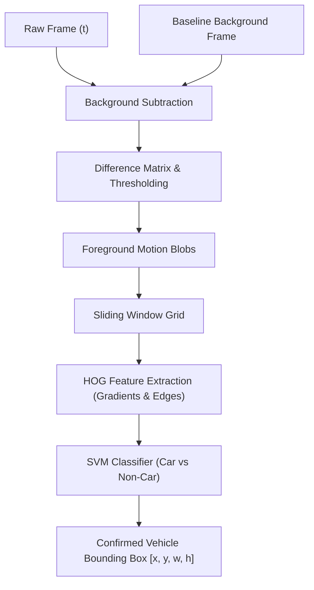
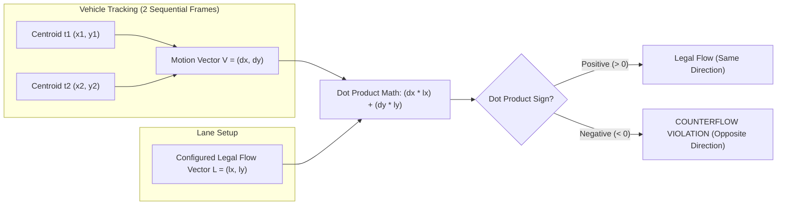

# Counterflow Detection — Algorithmic & Mathematical Foundations

This document details the fundamental algorithms and pure mathematical principles behind vehicle detection and counterflow detection without relying on modern deep learning frameworks.

---

## 1. Traditional Vehicle Detection (Without Deep Learning AI)

Before deep learning architectures like YOLO, vehicle detection was performed using classical computer vision and geometry.

### Pipeline Visualization

### Detailed Breakdown

#### Step 1: Background Subtraction (Motion Isolation)
* **Mathematical Principle:** Difference matrix of frame pixel values against a baseline background frame.
* **Formula:** $\Delta I(x, y) = |I_{current}(x,y) - I_{background}(x,y)|$
* **Mechanism:** Pixels where the difference exceeds a threshold $T$ are flagged as foreground objects. Connected component labeling groups these pixels into bounding boxes.

#### Step 2: Feature Extraction via HOG (Histogram of Oriented Gradients)
* **Mathematical Principle:** Measuring magnitude and orientation of intensity gradients across localized pixel grids.
* **Mechanism:** 
  1. Compute horizontal ($g_x$) and vertical ($g_y$) pixel gradients.
  2. Compute magnitude $M(x,y) = \sqrt{g_x^2 + g_y^2}$ and orientation $\theta(x,y) = \arctan\left(\frac{g_y}{g_x}\right)$.
  3. Construct gradient direction histograms for small cell grids.
  4. Compare extracted features against a known vehicle profile (wheels, windshield, rooflines) using a Support Vector Machine (SVM) classifier.

#### Step 3: Sliding Window Search
* **Mechanism:** A fixed aspect-ratio bounding box slides across the entire image grid at multiple scales to evaluate HOG features and locate candidate vehicles.

---

## 2. Mathematical Counterflow Evaluation

Once a vehicle is located across sequential video frames, counterflow is determined using vector algebra.

### Vector Evaluation Visualization

### Core Variables Breakdown

* **$dx, dy$ (Vehicle Motion):** Displacements in video pixel space between consecutive frames.
  * **$dx$:** Horizontal pixel movement (Positive = Right, Negative = Left).
  * **$dy$:** Vertical pixel movement.
* **$lx, ly$ (Legal Direction Vector):** Derived when the admin draws an arrow on the UI.
  * Computed as: $lx = \text{End}_X - \text{Start}_X$ and $ly = \text{End}_Y - \text{Start}_Y$.

---

## 3. End-to-End Concrete Math Worked Example

Imagine a highway camera where traffic is configured to flow strictly to the **Right**.

### Step 1: Lane Configuration Setup
The admin draws an arrow from left to right on the dashboard UI:
* **Start Point (Tail):** $(X = 10, Y = 10)$
* **End Point (Head):** $(X = 20, Y = 10)$
* **Legal Vector Component:**
  $$lx = 20 - 10 = 10, \quad ly = 10 - 10 = 0 \implies \vec{L} = (10, 0)$$

### Step 2: Camera Tracks Vehicle Centroids
The vision pipeline detects a vehicle and computes its center point across two consecutive frames:
* **Frame 1 Centroid:** $(X = 100, Y = 50)$
* **Frame 2 Centroid:** $(X = 80, Y = 50)$

### Step 3: Compute Vehicle Motion Vector $\vec{V}$
Subtract Frame 1 centroid coordinates from Frame 2:
$$dx = 80 - 100 = -20$$
$$dy = 50 - 50 = 0$$
$$\vec{V} = (-20, 0) \quad (\text{The vehicle moved 20 pixels to the Left})$$

### Step 4: Dot Product Calculation
Compute the dot product of $\vec{V} \cdot \vec{L}$:
$$\vec{V} \cdot \vec{L} = (dx \times lx) + (dy \times ly)$$
$$\vec{V} \cdot \vec{L} = (-20 \times 10) + (0 \times 0) = -200$$

### Step 5: Violation Decision
* **Calculated Value:** $-200$
* **Verdict:** Since the dot product is **Negative** ($< 0$), the vehicle's direction directly opposes the legal lane vector $\vec{L}$, triggering an immediate **COUNTERFLOW VIOLATION**.
